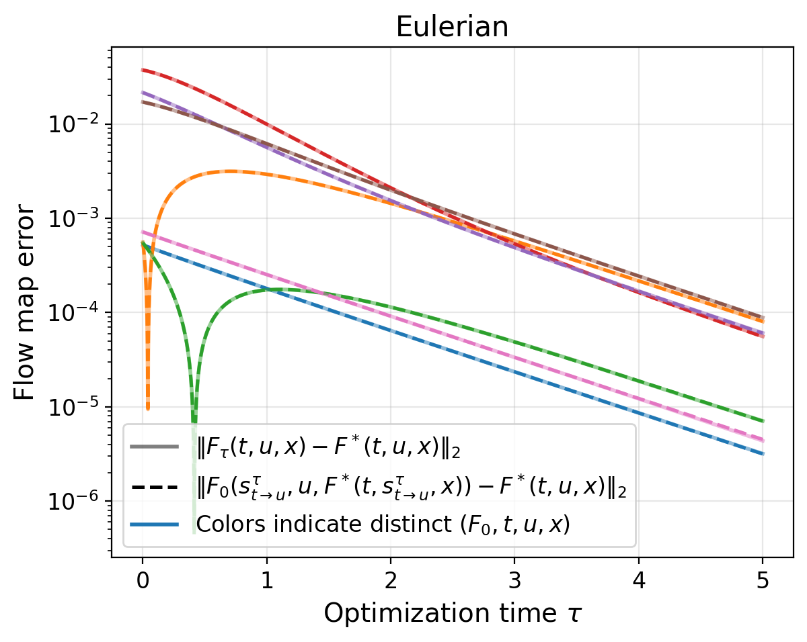
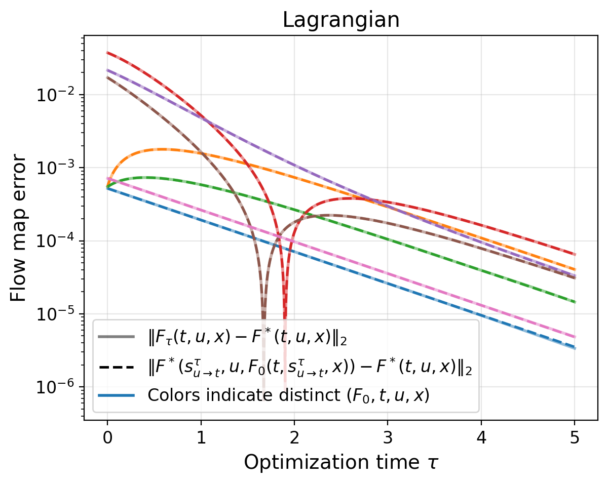
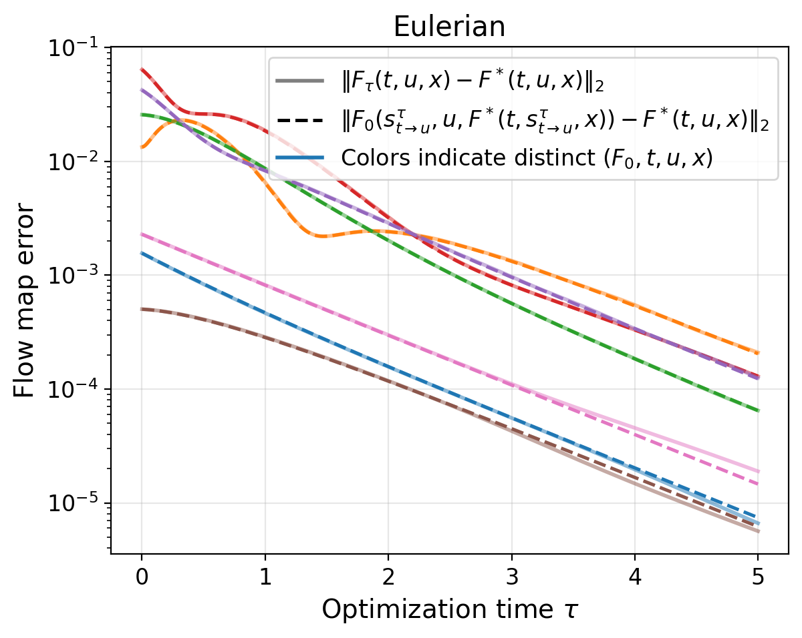
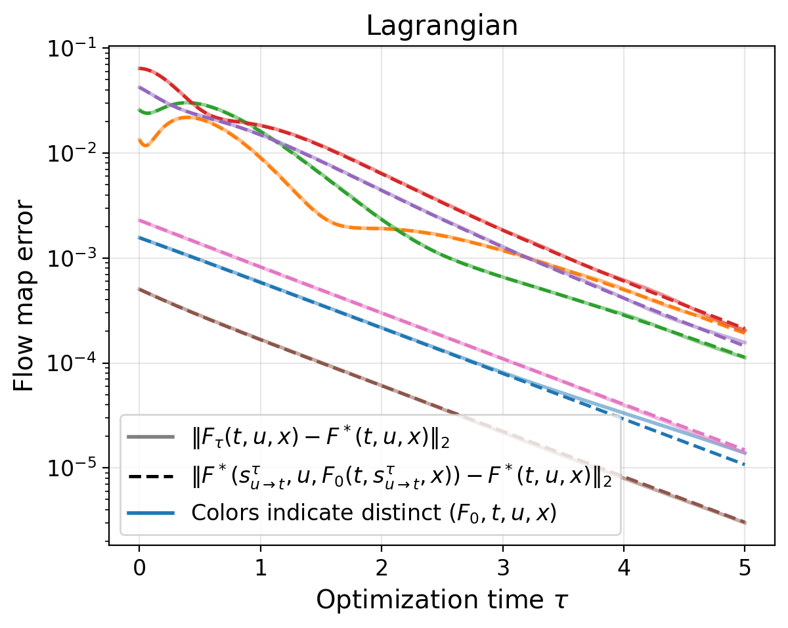

# Reference figures

The pointwise plots follow the manuscript's setup: seven colored curves, each
for a distinct $(F_0,t,u,x)$, over optimization time $\tau\in[0,5]$. Solid lines
show the simulated error to the true flow map; dashed lines show the explicit
prediction. The curves use one initial map at seven deterministic probe locations.
They are not independent training seeds.

The 1D grid has 61 time points and 121 spatial points, matching the manuscript's
pointwise figure; both regenerated 1D log-error plots are pixel-identical to
the manuscript images. The 2D example uses 31 time points and 31 points per spatial
axis. Both use float64 and automatically selected step sizes. Scatter plots
and checkpoint diagnostics cover $\tau\in[0,0.2]$; pointwise curves cover
$\tau\in[0,5]$. Each `summary.json` records the step sizes and probe coordinates.

Run from the repository root:

```bash
for dim in 1 2; do
  OMP_NUM_THREADS=1 MKL_NUM_THREADS=1 MPLBACKEND=Agg \
    python numerical_experiments/sim_func_grad_flow/sim_functional_grad_flow.py \
      --spatial_dim "$dim" --mode both --device cuda --plot_kind both \
      --num_f0s 1 --pointwise_num_curves 7 --pointwise_tau_final 5 \
      --output_dir outputs/convergence
done
```

The saved runs used CUDA with Python 3.11.15,
PyTorch 2.10.0+cu128, NumPy 2.4.2, Matplotlib 3.10.8 and tqdm 4.67.3.
Both dimensions can also be run entirely on CPU.

## 1D pointwise error





## 2D pointwise error




